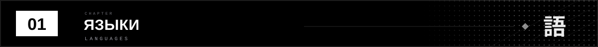
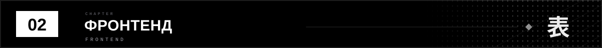
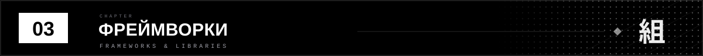
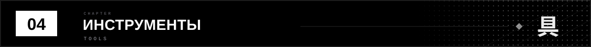
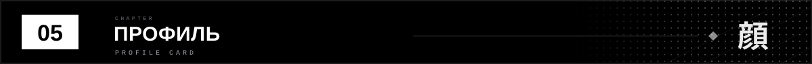
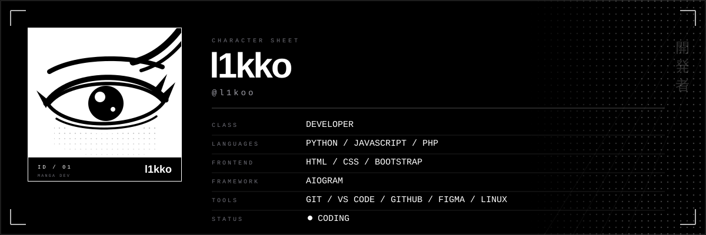
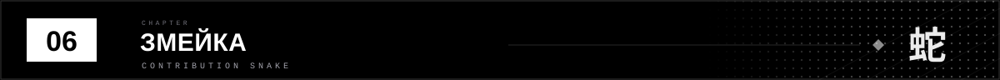
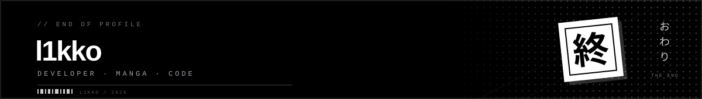

  

  

  「コードを書く。夢を見る。」 · I write code. I dream.

 

  

  &nbsp;
  &nbsp;
  

 

  

  &nbsp;
  &nbsp;
  

 

  

  

 

  

  &nbsp;
  &nbsp;
  &nbsp;
  &nbsp;
  

 

  

  

 

  

<picture>
  <source media="(prefers-color-scheme: dark)" srcset="https://raw.githubusercontent.com/l1koo/l1koo/output/github-snake-dark.svg" />
  <source media="(prefers-color-scheme: light)" srcset="https://raw.githubusercontent.com/l1koo/l1koo/output/github-snake.svg" />
  
</picture>

Змейка делает ням ням.

 

  

  Сделано чёрной тушью, белой бумагой и слишком большим количеством кофе.

